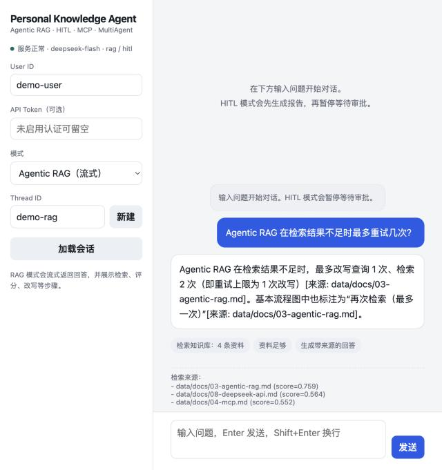
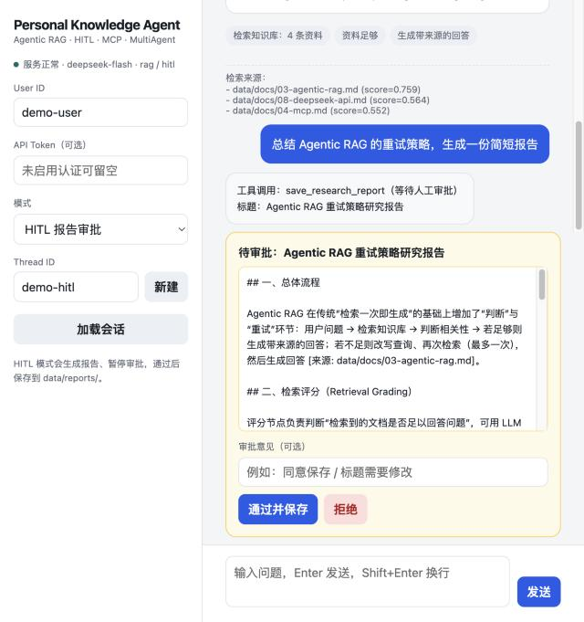
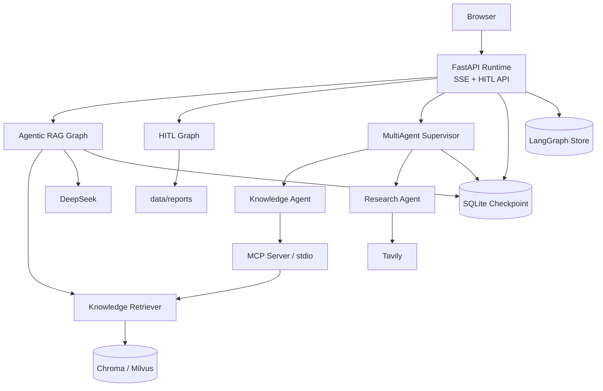

# Personal Knowledge Research Agent

一个面向个人技术文档的 AI Agent：本地知识库 RAG、联网研究、多 Agent 协作、长期记忆、人工审批和可部署 Web UI。

[](https://github.com/haomj/personal-knowledge-agent/actions/workflows/ci.yml)
[](LICENSE)

> 当前版本：**v1.1.0** · Day 10 交付 + Milvus 扩展 · 50 个离线测试 + 6 个真实 API 测试

> 技术栈：LangGraph · LangChain 1.x · DeepSeek · DashScope Embedding · Chroma / Milvus · MCP · FastAPI · SQLite · Docker

## 项目亮点

- **Agentic RAG**：检索后先判断资料是否足够，不足时改写查询并最多重试一次，回答带来源引用。
- **MCP 工具**：独立 stdio MCP Server 暴露 `list_documents` / `search_documents`，Agent 通过 MCP Client 调用。
- **MultiAgent**：Supervisor 将本地知识与联网研究委派给两个专业 Agent，再做结果汇总。
- **Memory**：SQLite checkpointer 恢复会话；LangGraph Store 按用户保存长期偏好。
- **HITL**：正式报告保存前通过真实 `interrupt()` 暂停，人工审批后恢复。
- **Middleware**：日志、角色权限、只读工具重试三层横切逻辑。
- **Web Runtime**：FastAPI + SSE 流式对话、工具步骤展示、HITL 审批卡片。
- **Docker**：非 root 镜像、命名 volume 持久化、健康检查、可选 API Token。

## 演示

Agentic RAG：流式回答、检索/评分/生成步骤和来源。



HITL：生成报告后暂停，等待人工审批。



## 架构



更详细的设计见 [docs/architecture.md](docs/architecture.md)。

## 功能清单

| 模块 | 状态 | 说明 |
| --- | --- | --- |
| 基础 Agent | ✅ | LangGraph `START -> agent -> END`，流式输出 |
| Agentic RAG | ✅ | 10 篇文档、22 chunks、检索评分、查询改写、来源 |
| 向量库后端 | ✅ | Chroma（默认）与 Milvus（Lite/远程）可切换 |
| Memory | ✅ | SQLite checkpoint + Store 用户偏好 |
| MCP | ✅ | stdio Server/Client，两个知识库工具 |
| MultiAgent | ✅ | Supervisor + Knowledge/Research Agent |
| HITL | ✅ | `interrupt()`、`Command(resume)`、幂等保存 |
| Middleware | ✅ | Logging / Permission / Retry |
| Web Runtime | ✅ | FastAPI、SSE、HITL API、最小 Chat UI |
| Docker | ✅ | Compose、volume、健康检查、可选 Token |
| 多用户认证 | ❌ | 当前只有共享 Token，不是完整身份系统 |
| 生产级可观测性 | ❌ | 目前为应用日志，后续接 LangSmith/OTel |

## 快速开始（本地）

需要 Python 3.12 和 [uv](https://docs.astral.sh/uv/)。

```bash
uv sync
```

复制环境变量模板：

```bash
cp .env.example .env
```

至少填入：

```dotenv
DEEPSEEK_API_KEY=...
DEEPSEEK_BASE_URL=https://api.deepseek.com
MODEL_NAME=deepseek-flash

DASHSCOPE_API_KEY=...
DASHSCOPE_BASE_URL=https://dashscope.aliyuncs.com/compatible-mode/v1
EMBEDDING_MODEL=text-embedding-v4

TAVILY_API_KEY=...
```

建立本地知识库索引：

```bash
uv run python -m app.rag.ingest
```

启动 Web UI：

```bash
uv run personal-knowledge-web
```

打开：

```text
http://127.0.0.1:8000
```

## 切换向量库：Chroma / Milvus

默认使用 Chroma，无需额外配置：

```dotenv
VECTOR_STORE=chroma
CHROMA_DIR=data/chroma
CHROMA_COLLECTION=knowledge_base
```

切换到 Milvus：

```dotenv
VECTOR_STORE=milvus
# Milvus Lite 本地文件
MILVUS_STORE_URI=data/milvus.db
# 或远程 Milvus Server
# MILVUS_STORE_URI=http://localhost:19530
MILVUS_COLLECTION=knowledge_base
MILVUS_TOKEN=
MILVUS_INDEX_TYPE=AUTOINDEX
MILVUS_METRIC_TYPE=COSINE
```

重建对应后端的索引：

```bash
# Chroma
uv run python -m app.rag.ingest --backend chroma
```

```bash
# Milvus Lite
uv run python -m app.rag.ingest --backend milvus --milvus-uri data/milvus.db
```

使用 Milvus 运行 Agent：

```bash
VECTOR_STORE=milvus uv run python -m app.cli --question "Agentic RAG 最多重试几次？"
```

> Chroma 与 Milvus 的索引相互独立；切换后端后需要重新 ingest。  
> `MILVUS_STORE_URI` 是应用专用变量；不要用本地文件路径覆盖 `MILVUS_URI`，因为 pymilvus 会在 import 时读取它。  
> 详见 [docs/vector-store-backends.md](docs/vector-store-backends.md)。

## 运行模式

```bash
# 默认：Agentic RAG + Memory
uv run python -m app.cli

# 基础对话
uv run python -m app.cli --mode basic

# MCP Agent
uv run python -m app.cli --mode mcp --question "MCP 的 stdio 适合什么场景？"

# MultiAgent
uv run python -m app.cli --mode multi \
  --question "结合本地 Agentic RAG 文档和 LangGraph 最新版本，给我一个总结。"

# HITL 报告审批
uv run python -m app.cli --mode hitl \
  --question "总结 Agentic RAG 的重试策略" \
  --hitl-decision approve

# Middleware 演示
uv run python -m app.cli --mode middleware --role viewer \
  --question "请调用 save_research_report 保存报告。"
```

## Docker

```bash
cp .env.example .env
```

首次构建并建立索引：

```bash
docker compose build
```

```bash
docker compose run --rm agent python -m app.rag.ingest
```

启动：

```bash
docker compose up -d
```

默认使用 Chroma。若要切换 Milvus，在 `.env` 设置：

```dotenv
VECTOR_STORE=milvus
MILVUS_STORE_URI=/app/data/milvus.db
MILVUS_COLLECTION=knowledge_base
MILVUS_METRIC_TYPE=COSINE
```

然后重建索引并重启：

```bash
docker compose run --rm agent python -m app.rag.ingest --backend milvus
```

```bash
docker compose up -d
```

查看状态：

```bash
docker compose ps
```

```bash
docker compose logs -f agent
```

关闭但保留数据：

```bash
docker compose down
```

数据在命名 volume `pka-data` 中；`docker compose down -v` 会删除数据。

如果宿主机使用本地代理（如 `127.0.0.1:7897`），在 `.env` 设置：

```dotenv
DOCKER_HTTP_PROXY=http://host.docker.internal:7897
DOCKER_NO_PROXY=localhost,127.0.0.1
```

具体排错见 [docs/day09-deployment.md](docs/day09-deployment.md)。

## 测试

一次性运行离线测试 + 逐文件真实 API 测试：

```bash
RUN_LIVE_TESTS=1 ./scripts/verify.sh
```

只跑离线测试：

```bash
uv run pytest -q
```

当前结果：

```text
50 passed, 6 skipped
```

真实 API 测试：

```text
test_smoke_live.py       2 passed
test_rag_live.py         1 passed
test_mcp_live.py         2 passed
test_multiagent_live.py  1 passed
```

> 真实测试按文件运行，避免不同 `asyncio.run` 之间异步 HTTP 客户端清理互相影响。

## API

| 方法 | 路径 | 作用 |
| --- | --- | --- |
| GET | `/` | Web Chat UI |
| GET | `/api/health` | 健康检查 |
| POST | `/api/threads` | 生成 thread_id |
| GET | `/api/threads/{thread_id}` | 消息/来源/待审批状态 |
| POST | `/api/chat/stream` | RAG SSE 流式对话 |
| POST | `/api/hitl/start` | 生成报告并暂停审批 |
| POST | `/api/hitl/resume` | 审批并恢复 |

详细请求/响应格式见 [docs/api.md](docs/api.md)。

## 目录

```text
app/
├── config.py        # 环境变量、模型/Embedding 工厂
├── state.py         # AgentState
├── graph.py         # 基础 Agent 图
├── cli.py           # rag/basic/mcp/multi/hitl/middleware
├── rag/             # 加载、切分、Embedding、Chroma/Milvus、RAG 图
├── mcp/             # MCP Server / Client / Agent
├── multiagent/      # Supervisor + 子 Agent
├── hitl/            # interrupt 审批图与报告保存
├── middleware/      # 日志、权限、重试
├── memory/          # SQLite checkpoint + Store
└── web/             # FastAPI Runtime + 静态 UI

data/
├── docs/            # 10 篇技术文档（提交）
├── chroma/          # Chroma 索引（不提交）
├── milvus.db        # Milvus Lite 索引（不提交）
├── checkpoints.sqlite
├── memory.sqlite
└── reports/         # 审批生成的报告（不提交）

docs/                # 每日源码/实验笔记 + 架构/API/部署
docs/assets/         # Web UI 演示截图
tests/               # 50 个离线测试 + 6 个真实 API 测试
scripts/verify.sh    # 一键验收
Dockerfile
compose.yaml
.github/workflows/ci.yml
```

## 文档索引

- [Day 1：LangGraph](docs/day01-langgraph.md)
- [Day 2：Agentic RAG](docs/day02-agentic-rag.md)
- [Day 3：Memory](docs/day03-memory.md)
- [Day 4：MCP](docs/day04-mcp.md)
- [Day 5：MultiAgent](docs/day05-multiagent.md)
- [Day 6：HITL](docs/day06-hitl.md)
- [Day 7：Middleware](docs/day07-middleware.md)
- [Day 8：Runtime API 与 Web UI](docs/day08-web-runtime.md)
- [Day 9：Docker 部署](docs/day09-deployment.md)
- [Day 10：端到端验收](docs/day10-e2e.md)
- [向量库后端：Chroma / Milvus](docs/vector-store-backends.md)
- [架构设计](docs/architecture.md)
- [API 说明](docs/api.md)

## 已知限制

- 当前认证是共享 `WEB_AUTH_TOKEN`，不是多用户登录/RBAC。
- SQLite checkpointer/store 适合单实例；多实例需要 Postgres/共享存储。
- 没有生产级 HTTPS、限流、CSRF、审计和指标。
- 真实 API 测试需要外部 Key；Docker 验收依赖本机 Docker Desktop。
- 没有自动记忆提取；长期偏好通过 `/remember` 显式保存。

## 后续路线

- GitHub Actions：离线测试、lint、Docker build。
- LangSmith / OpenTelemetry：请求级追踪与指标。
- Postgres checkpointer/store：多实例部署。
- 多用户认证与 RBAC。
- 报告下载、版本管理与审计。
- 更完整的 RAG 评估集（Recall@K、faithfulness）。

## License

MIT，详见 [LICENSE](LICENSE)。
