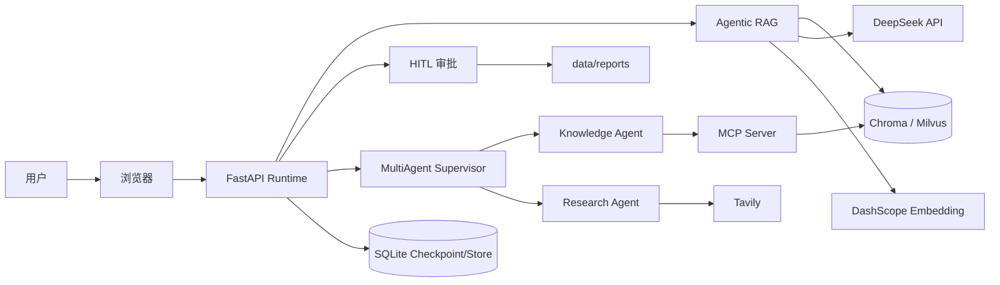
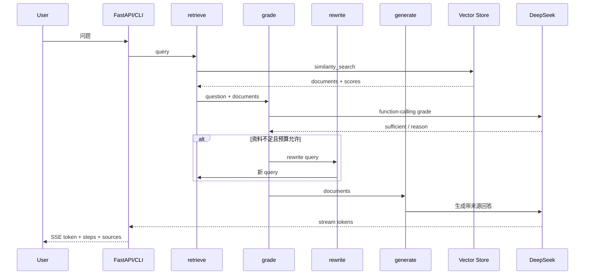
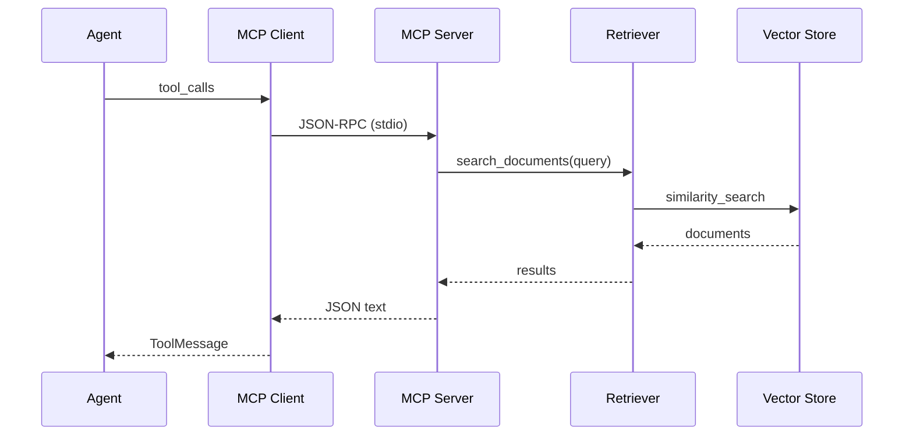
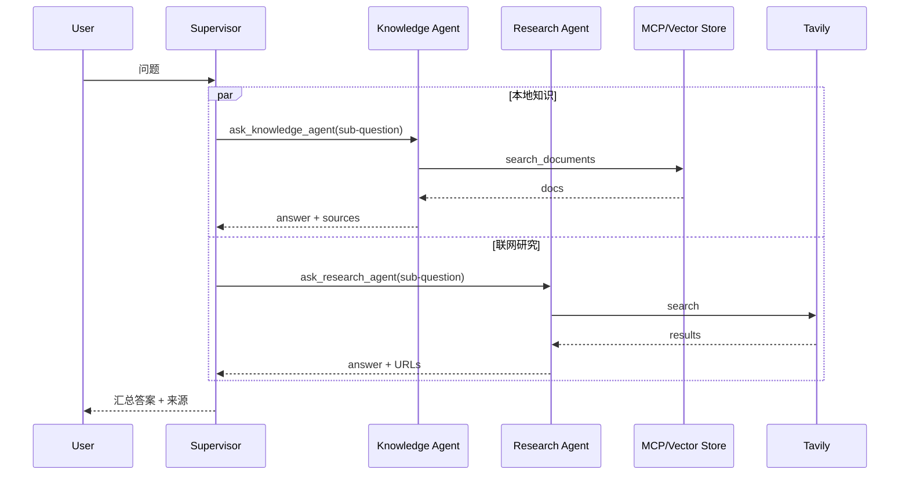
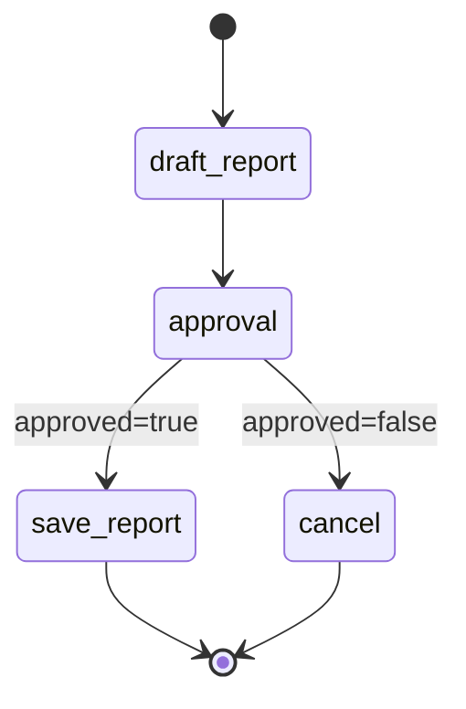
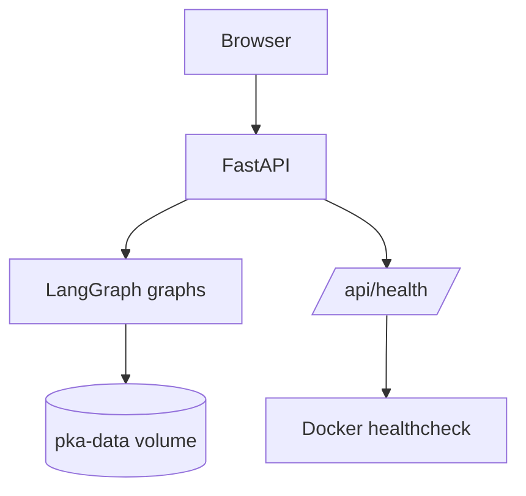

# 架构设计

## 1. 目标与边界

本项目定位为**单用户、单实例、可演示的个人知识研究 Agent**，重点展示：

- LangGraph 状态编排、条件路由、持久化、中断恢复；
- Agentic RAG 的检索评分与查询改写；
- MCP 工具协议与 stdio Server/Client；
- Supervisor + 专业子 Agent；
- HITL 审批与 Middleware 横切逻辑；
- FastAPI Runtime、SSE 与 Docker 部署。

非目标：

- 多租户 SaaS；
- 分布式 Agent Runtime；
- 大规模 RAG 评估平台；
- 企业级身份、审计与合规系统。

## 2. 系统上下文

## 3. 组件

| 组件 | 入口 | 职责 |
| --- | --- | --- |
| CLI | `app/cli.py` | 六种运行模式：rag/basic/mcp/multi/hitl/middleware |
| FastAPI | `app/web/server.py` | HTTP/SSE、线程状态、HITL API、认证、日志 |
| 基础图 | `app/graph.py` | `START -> agent -> END` |
| RAG 图 | `app/rag/graph.py` | retrieve -> grade -> generate / rewrite |
| 向量库层 | `app/rag/vector_store.py` | Chroma / Milvus 后端工厂 |
| HITL 图 | `app/hitl/graph.py` | draft -> interrupt -> save/cancel |
| MCP Server | `app/mcp/server.py` | `list_documents` / `search_documents` |
| MCP Client | `app/mcp/client.py` | 工具发现、调用、LangChain 工具加载 |
| MultiAgent | `app/multiagent/` | Supervisor + Knowledge/Research Agent |
| Middleware | `app/middleware/` | 日志、权限、重试 |
| Memory | `app/memory/` | SQLite checkpointer 与 Store |
| Web UI | `app/web/static/index.html` | 聊天、步骤、来源、审批卡片 |

## 4. 关键数据流

### 4.1 Agentic RAG

关键约束：

- 最多 1 次改写、2 次检索；
- 评分使用 DeepSeek `function_calling` 结构化输出；
- 生成提示词要求 `[来源: 文件路径]`；
- 检索来源按文件去重，保留最高分。

### 4.2 MCP

MCP Server 由 Client 作为子进程启动；stdout 用于 JSON-RPC，日志走 stderr。

### 4.3 MultiAgent

- Tool-based Handoff；
- 子 Agent 只接收子问题，实现 Context Isolation；
- 每次问题最多 3 次子任务、单个 Agent 最多 2 次；
- Supervisor 每次提问重建，预算按问题重置；checkpoint/Store 保持会话与偏好。

### 4.4 HITL

- `approval` 节点调用 `interrupt(payload)`；
- 恢复使用 `Command(resume={"approved": ...})`；
- 恢复时节点从头执行，因此副作用放在 `save_report`；
- checkpoint 保存暂停状态；同一 thread 重启后可恢复；
- 报告文件名由标题 + 内容哈希决定，重复保存幂等。

## 5. 状态与持久化

### 5.1 短期记忆

- `SqliteSaver`：CLI 同步图、Web RAG/HITL；
- `AsyncSqliteSaver`：MCP/MultiAgent 异步图；
- `thread_id` 是 checkpoint 主键；
- Web 使用 `mode:user_id:thread_id` 组合 key，避免用户/模式串线。

### 5.2 长期记忆

- `SqliteStore`；
- namespace：`("users", user_id, "preferences")`；
- 显式 `/remember key=value` 写入；
- 基础/RAG/多 Agent 生成时注入 system prompt。

## 6. Runtime 与部署

- 单容器：FastAPI + RAG/HITL + MCP stdio 子进程；
- 命名 volume `pka-data` 保存 checkpoint、Store、Chroma、报告；
- `data/docs` 只读 bind mount；
- 健康检查 `/api/health`；
- 可选 `WEB_AUTH_TOKEN` 共享 Token；
- 生产公网还需要 HTTPS、反向代理、限流、真实身份系统。

## 7. 设计取舍

| 决策 | 原因 | 代价 |
| --- | --- | --- |
| SQLite 持久化 | 单实例、零运维、易演示 | 不适合多实例/高并发 |
| Chroma 默认、Milvus 可选 | 保留本地轻量默认，兼顾 Milvus 生态 | 切换后端需要重建索引 |
| DeepSeek 生成 + DashScope Embedding | DeepSeek 无 Embedding API；DashScope 兼容 OpenAI | 两套 Key/供应商 |
| Chroma | 本地部署简单 | 大规模检索需专用向量库 |
| Tool-based Handoff | 比嵌套 Graph 易实现、易调试 | 复杂任务规划能力有限 |
| 自定义 HITL 图 | 明确展示 interrupt/resume 语义 | 未使用官方 HITL Middleware |
| 静态 HTML UI | 无前端构建、依赖少 | 交互能力弱于 Agent Chat UI |
| 共享 API Token | 最小认证 | 无用户身份、RBAC、审计 |

## 8. 安全边界

- `.env`、SQLite、Chroma/Milvus 索引、reports 不提交；
- Web 默认仅监听 `127.0.0.1`；
- Docker 非 root 运行；
- 高风险工具仅 admin（Middleware 演示）；
- HITL 审批只允许通过/拒绝，不支持编辑；
- 公网部署前必须补认证、HTTPS、限流和审计。
